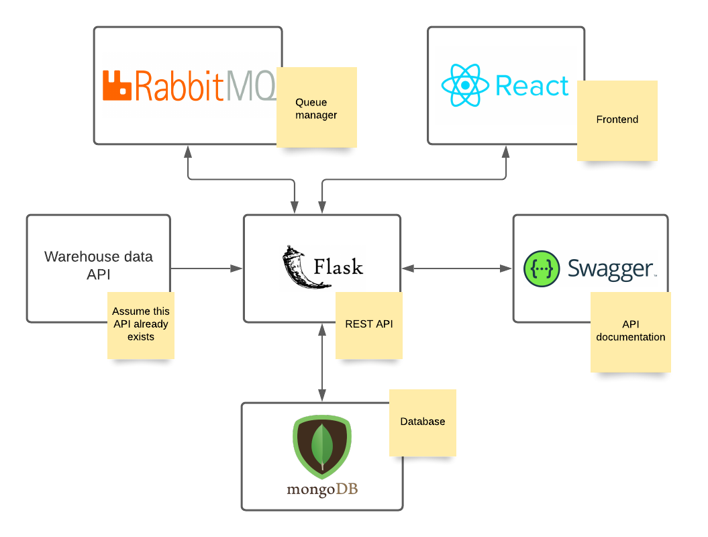

# Architecture

The following diagram illustrates our vertical's architecture. Due to all the uncertainties about the data that we will receive about the current state of the warehouse, we are assuming that there is a warehouse API, from where we can get all the online and offline data we need. Our REST API will periodically check the state of the warehouse, process the data and store it on a database. Then, our system will make that data available through a frontend and through a queue manager.

Tools used:

- Docker: The entire project will be built around Docker. It uses OS-level virtualization to deliver software containers which are isolated from one another and bundle their own software.

- Flask: Micro web framework written in Python. It will be used to build a REST API demonstrated in the picture above.

- Swagger: Interface Description LAnguage for describing RESTful APIs. It will by used to the document the API developed with Flask.

- MongoDB: Document-oriented database which will be responsible for storing the data.

- React: Front-end JavaScript library used to build a GUI representative of the data stored. It will contain metrics and plots allowing an easier visualization of the data.

- RabbitMQ - Message-broker software used to communicate information to other verticals.