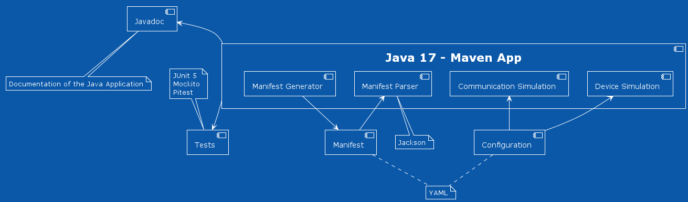

# Architecture

This vertical's architecture is defined in the following component diagram:

Tools:
- [Docker](https://www.docker.com/): Open source containerization platform. Will be used to package all the software into containers. Allows for better compatibility since the code executes in containers isolated from the OS.
- [Java](https://www.java.com/): The software for the simulation of devices' communication and behaviour will be developed using Java 17.
- [Maven](https://maven.apache.org/): To build and manage our Java project more easily, we will be using the Maven build automation tool. This tool allows for better dependency handling and is supported in the most popular IDEs.
- [Javadoc](https://www.oracle.com/java/technologies/javase/javadoc-tool.html): API documentation generator for the Java source code.
- Jackson: Java-based library that will be used to parse and manipulate YAML configuration files.