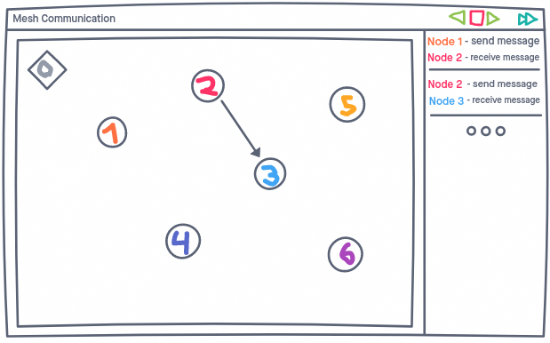
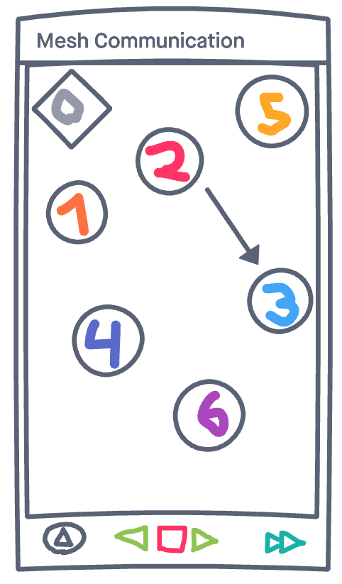

# Product Vision

Simulate the communication between devices in a mesh network, and provide
battery consumption and message statistics.

## Details

For the user working with the mesh network of devices, the app provides a way to
simulate the network's inner workings with detailed reporting and fine time
controls.

## Elevator pitch

People working with mesh networks need a tool to help them decide on the best
configuration for said devices. This project allows them to see all interactions
on a given scenario in a detailed manner, and evaluate what's the best way to
organize everything based on the given statistics.

## MVP Mock up - PC Client

## MVP Mock up - Phone Client

