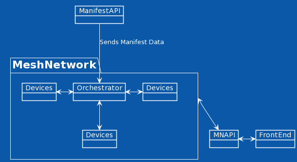
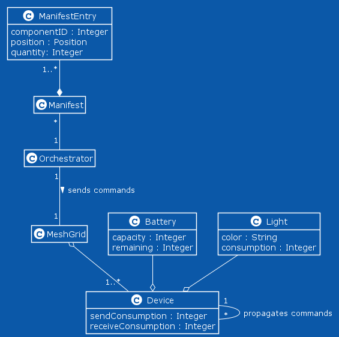

# Mesh Communication

## Description

The purpose of this vertical is to develop an application for simulating the behaviour of the devices used in the warehouse. Using this application, it is possible to generate warehouse manifests and simulate the devices' actions and communication, allowing for a simple visualization of the device mesh grid and custom configurations (such as failure rate of the devices and communication, battery capacities and energy consumptions).

## UML Class Diagram

 